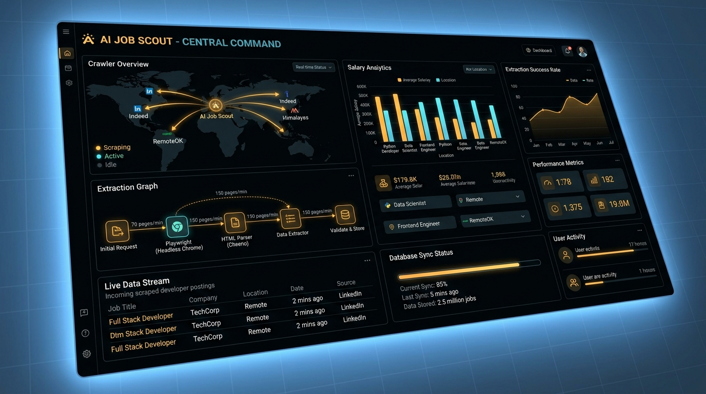
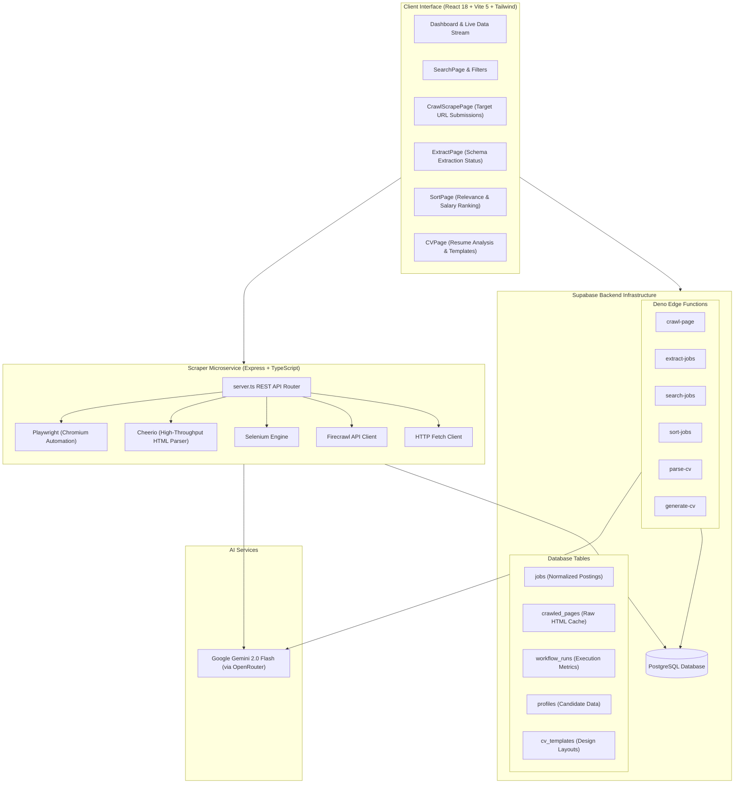
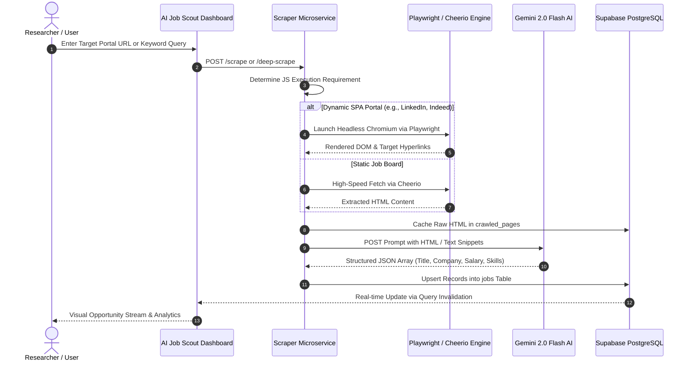

<div align="center">

# 🛰️ AI Job Scout

**Autonomous Multi-Engine Web Crawler, Recruitment Intelligence Engine & Automated Job Aggregator**

[](https://www.typescriptlang.org/)
[](https://react.dev/)
[](https://vitejs.dev/)
[](https://supabase.com/)
[](https://playwright.dev/)
[](https://www.docker.com/)
[](https://deepmind.google/technologies/gemini/)

<br />



<br />

[Features](#-core-capabilities) • [Architecture](#-system-architecture) • [Crawling Pipeline](#-crawler--extraction-pipeline) • [Scraper Service](#-multi-engine-crawler-microservice) • [Lineage & Ecosystem](#-ecosystem-evolution--lineage) • [Quickstart](#-quickstart--installation)

</div>

---

## 🌟 Executive Overview

**AI Job Scout** is an autonomous web crawling and recruitment intelligence platform designed to scrape, extract, aggregate, and classify employment opportunities from across the open web.

Engineered with a **distributed multi-engine scraping microservice** (combining Playwright, Selenium, Cheerio, Firecrawl, and HTTP Fetch) and powered by **Google Gemini 2.0 Flash AI**, AI Job Scout bypasses anti-bot barriers and single-page application (SPA) client rendering to transform unstructured career pages into clean, queryable opportunity streams.

---

## 💡 Ecosystem Evolution & Lineage

> [!NOTE]
> **AI Job Scout** established the foundational web scraping microservice, database schemas, and edge computing architecture for automated job discovery. For the next-generation iteration featuring advanced interactive multi-item CV profile editing and enhanced ATS tailoring, explore its sister project: [ATS Genius](https://github.com/Userbi254/ats-genius).

---

## ⚡ Core Capabilities

### 1. 🕷️ Multi-Engine Autonomous Web Crawling
- **SPA Rendering via Playwright**: Runs headless Chromium sessions to dynamically render JavaScript on complex portals (LinkedIn, Indeed, Glassdoor, Himalayas, RemoteOK, WeWorkRemotely, Wellfound, FlexJobs, Fuzu).
- **Lightweight Cheerio Parser**: Fast regex and DOM parsing for static job boards and high-throughput link extraction.
- **Deep Scraping**: Traverses parent career listings to discover pagination routes and follow individual job specification URLs.

### 2. 🤖 Gemini AI Structuring & Normalization
- **Intelligent Schema Extraction**: Automatically detects and normalizes:
  - Role titles and level classifications (Junior, Mid, Senior, Lead).
  - Hiring companies and verified domains.
  - Compensation packages and currency detection.
  - Required technical stack and core competencies.
  - Remote vs. on-site vs. hybrid policy.
- **Database Caching**: Persists raw HTML responses in `crawled_pages` and structured opportunities in `jobs` with complete deduplication.

### 3. 🎯 Candidate Fit Scoring & Sorting
- **Semantic Ranking**: Compares extracted vacancy requirements against candidate profiles.
- **Multi-Parametric Filtering**: Instant filtering by compensation, remote status, verified recruiter, and tech stack tags.

### 4. 📄 Document Ingestion & Template Formatting
- **Client-Side Document Parsing**: Ingests **PDF** and **DOCX** resumes client-side via `pdfjs-dist` and `mammoth`.
- **CV Template Engine**: Supports multiple pre-configured layout templates (`Professional`, `Modern`, `Minimal`, `Creative`).
- **Export Capabilities**: Exports documents to PDF via `jspdf` and `html2canvas`.

---

## 🏗️ System Architecture



---

## 🔄 Crawler & Extraction Pipeline



---

## 🕷️ Multi-Engine Crawler Microservice

Located in the `scraper/` directory, this Node.js/TypeScript microservice handles intensive browser automation outside the frontend runtime:

### Core Services Structure
- `scraper/services/playwright.ts`: Manages headless browser pools, page navigation, scroll triggering, and screenshot telemetry.
- `scraper/services/cheerio.ts`: High-speed HTML text conversion and hyperlinked URL harvesting.
- `scraper/services/gemini.ts`: Direct AI prompt engineering for converting unstructured job descriptions into typed JSON schemas.
- `scraper/services/supabase.ts`: Direct backend persistence for high-throughput batch operations.
- `scraper/Dockerfile`: Container configuration including all Playwright and Chromium dependencies for cloud deployment.
- `scraper/render.yaml`: Production deployment manifest for Render.com web services.

---

## 📁 Repository Structure

```
ai-job-scout/
├── docs/
│   └── assets/
│       └── banner.jpg        # Central command interface banner
├── scraper/                  # Multi-Engine Crawler Microservice
│   ├── services/             # Playwright, Cheerio, Selenium, Gemini services
│   ├── Dockerfile            # Container build specification
│   ├── package.json          # Scraper microservice dependencies
│   ├── render.yaml           # Render deployment configuration
│   └── server.ts             # REST API server entrypoint
├── src/
│   ├── components/           # UI components & Radix / Shadcn widgets
│   ├── contexts/             # Theme & Sidebar navigation state
│   ├── pages/                # Dashboard, Search, Crawl, Extract, Sort, CV, Trash
│   ├── App.tsx               # Primary application routing
│   └── main.tsx              # Application entrypoint
├── supabase/
│   ├── functions/            # 6 Deno Edge Functions
│   └── migrations/           # Database schemas, templates & RLS policies
├── package.json              # Frontend dependencies and build scripts
├── tailwind.config.ts        # Tailwind CSS styling configuration
└── vite.config.ts            # Vite 5 bundle configuration
```

---

## 🛠️ Quickstart & Installation

### 1. Frontend Setup

```bash
# Clone the repository
git clone https://github.com/Userbi254/ai-job-scout.git
cd ai-job-scout

# Install dependencies
npm install

# Configure environment variables (.env)
VITE_SUPABASE_URL=https://your-project.supabase.co
VITE_SUPABASE_PUBLISHABLE_KEY=your-supabase-anon-key
VITE_SUPABASE_PROJECT_ID=your-project-id

# Run Vite dev server
npm run dev
```

### 2. Crawler Microservice Setup

```bash
cd scraper

# Install dependencies
npm install

# Install Playwright browser dependencies
npx playwright install chromium

# Configure environment variables (.env)
PORT=3001
GEMINI_API_KEY=your-gemini-api-key
SUPABASE_URL=https://your-project.supabase.co
SUPABASE_SERVICE_ROLE_KEY=your-service-role-key

# Start the scraper microservice
npm run dev
```

---

## 🚀 Deployment Guide

### Container Deployment with Docker
```bash
# Build the crawler container
docker build -t ai-job-scout-crawler ./scraper

# Run container with environment configuration
docker run -d -p 3001:3001 --env-file ./scraper/.env ai-job-scout-crawler
```

### Edge Functions Deployment
```bash
supabase functions deploy crawl-page
supabase functions deploy extract-jobs
supabase functions deploy search-jobs
supabase functions deploy sort-jobs
supabase functions deploy parse-cv
supabase functions deploy generate-cv
```

---

## 📄 License & Attribution

Distributed under the MIT License. Developed with pride by [Userbi254](https://github.com/Userbi254).
